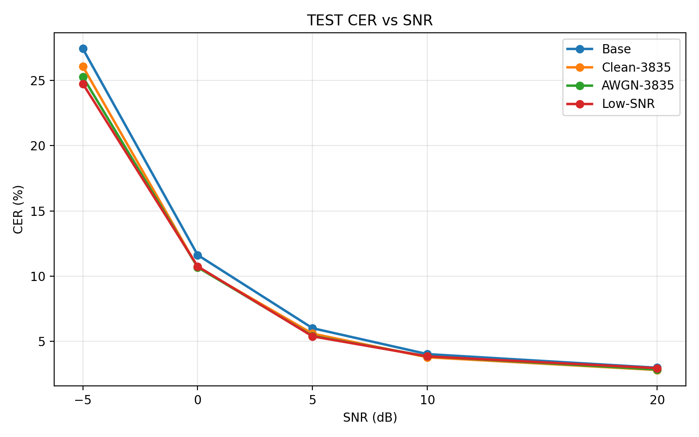
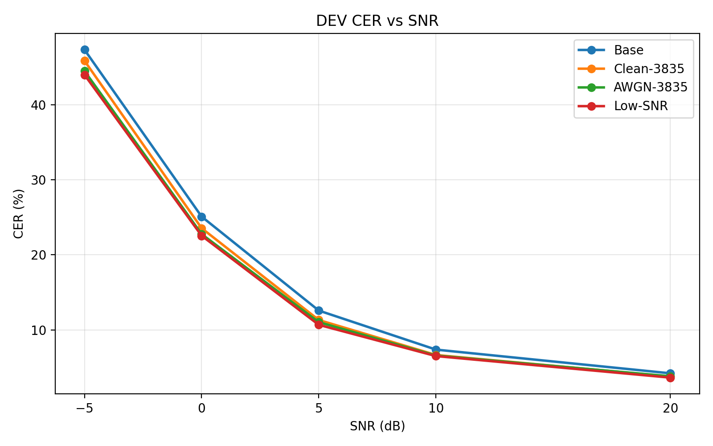

# SenseVoice-Noise-Robust-ASR

基于 SenseVoiceSmall 的低信噪比噪声鲁棒中文语音识别项目。

本项目基于预训练 SenseVoiceSmall，采用动态 AWGN（加性高斯白噪声）数据增强与低信噪比定向微调策略，研究不同训练噪声范围对中文语音识别性能的影响。

## 1. 项目背景

自动语音识别（ASR）模型在干净语音环境下通常具有较好的识别效果，但随着噪声强度增加，识别错误率可能明显上升。

本项目重点研究低信噪比环境下的中文语音识别问题，使用 AISHELL-1 数据集开展模型微调，并通过多信噪比 CER 评估验证训练策略的有效性。

## 2. 技术栈

- Python 3.10
- PyTorch 2.5.1
- Torchaudio 2.5.1
- FunASR 1.4.16
- ModelScope 1.40.2
- SenseVoiceSmall
- AWGN 数据增强
- CER（Character Error Rate）

## 3. 技术方案

项目整体流程：

```text
AISHELL-1 中文语音
        |
        v
语音预处理与数据清单构建
        |
        v
动态 AWGN 数据增强
        |
        v
SenseVoiceSmall 微调
        |
        v
多信噪比语音识别
        |
        v
CER 计算与对照实验
```

### 3.1 Clean-3835

使用 3835 条干净中文语音微调预训练 SenseVoiceSmall。

目的：建立干净语音微调对照组，区分模型微调本身与噪声增强带来的性能收益。

### 3.2 AWGN-3835

在同样的 3835 条语音上引入动态 AWGN 数据增强：

- 80% 概率进行噪声增强；
- 20% 概率保留干净语音；
- 带噪样本的 SNR 从 -5～20 dB 随机采样。

目的：验证宽信噪比范围的数据增强是否有助于提高带噪语音识别性能。

### 3.3 Low-SNR

采用与 AWGN-3835 相同的基础模型与训练数据，将带噪样本的 SNR 采样范围调整为 -5～5 dB。

目的：验证低信噪比定向训练能否进一步提高强噪声环境下的识别性能。

## 4. 实验设置

| 项目 | 设置 |
|---|---|
| 基础模型 | SenseVoiceSmall |
| 训练数据 | AISHELL-1 训练子集 |
| 训练语音 | 3835 条 |
| 训练说话人 | 11 名 |
| 微调轮数 | 1 Epoch |
| 优化器 | AdamW |
| 初始学习率 | 2e-5 |
| 噪声类型 | AWGN |
| 评估条件 | Clean、20、10、5、0、-5 dB |
| 评估指标 | CER |

本项目分别使用 Dev 200 和 Test 200 子集进行评估。Test 200 来自未参与训练的 AISHELL-1 测试说话人 S0764，共 200 条语音。

需要注意，Test 200 并非完整 AISHELL-1 官方测试集，仅用于本项目的独立子集验证。

## 5. 实验结果

### 5.1 Test 200 CER 对比

CER 越低越好。

| SNR | 原始模型 | Clean-3835 | AWGN-3835 | Low-SNR |
|---|---:|---:|---:|---:|
| Clean | 2.8532% | 2.8184% | 2.7836% | **2.7488%** |
| 20 dB | 2.9923% | **2.8184%** | 2.8532% | 2.9576% |
| 10 dB | 4.0362% | **3.7926%** | 3.8622% | 3.8622% |
| 5 dB | 6.0195% | 5.6019% | 5.4280% | **5.3932%** |
| 0 dB | 11.6214% | **10.6820%** | **10.6820%** | 10.7516% |
| -5 dB | 27.4182% | 26.0612% | 25.2610% | **24.7390%** |

在 -5 dB 条件下，Low-SNR 模型相对于原始 SenseVoiceSmall：

- CER 从 27.4182% 降低至 24.7390%；
- 绝对下降 2.6792 个百分点；
- 相对下降约 9.77%。

相对于 Clean-3835 对照组，CER 相对下降约 5.07%。

这些结果表明，在当前独立测试子集和 AWGN 实验设置下，低信噪比定向增强具有一定收益，但 Low-SNR 模型并非在所有噪声条件下都是最优模型。

### 5.2 CER–SNR 实验曲线

**独立 Test 200 测试结果：**



**Dev 200 验证结果：**



两张曲线使用相同的信噪比测试条件。不同数据子集的识别难度可能不同，因此应在同一数据子集内比较训练策略的效果。

### 5.3 单条语音 Demo

以下案例从 -5 dB 测试结果中筛选，用于直观展示模型差异。

**正确文本：**

> 研究者们选取了十九位跑者

**原始 SenseVoiceSmall：**

> 研究者每天学了十九页考稿

CER：50.00%

**Low-SNR 微调模型：**

> 研究者们选取了十九位考稿

CER：16.67%

该案例为筛选得到的单条演示样本，不能代表整体性能。完整结果请参考上表及 `results/` 目录。

## 6. 项目结构

```text
SenseVoice-Noise-Robust-ASR/
├── configs/                 # 训练配置
├── preprocessors/           # 动态 AWGN 增强与数据集实现
├── results/                 # CER 实验汇总结果
├── demo.py                  # 单条语音识别 Demo
├── evaluate.py              # 通用多信噪比评估脚本
├── train_awgn.py            # 训练入口
├── requirements.txt         # 依赖环境
└── README.md
```

## 7. 环境配置

建议使用 Python 3.10。

```bash
pip install -r requirements.txt
```

PyTorch 和 Torchaudio 的安装应与本机 CUDA 环境匹配。本项目实验环境使用 PyTorch 2.5.1+cu121。

## 8. 推理 Demo

准备好 SenseVoiceSmall 基础模型，以及对应的微调权重后，执行：

```bash
python demo.py \
  --audio /path/to/test.wav \
  --snr -5 \
  --base-model /path/to/SenseVoiceSmall \
  --checkpoint /path/to/model_lowsnr_finetuned.pt \
  --reference "研究者们选取了十九位跑者"
```

要求输入音频为 16 kHz、单声道 WAV 文件。

Demo 将输出原始模型和微调模型的识别文本。如果提供 `--reference`，还会输出单条语音的 CER。

处理后的 WAV 和 JSON 结果保存在 `demo_outputs/` 目录。

注意：本仓库不直接提供微调模型权重，使用 Demo 前需要准备与代码兼容的权重文件。

## 9. 批量 CER 评估

测试清单 CSV 至少包含：

```csv
audio_path,reference
/path/to/example.wav,示例语音对应的文字
```

运行原始模型评估：

```bash
python evaluate.py \
  --manifest /path/to/test.csv \
  --base-model /path/to/SenseVoiceSmall \
  --output results/base_test
```

运行微调模型评估：

```bash
python evaluate.py \
  --manifest /path/to/test.csv \
  --base-model /path/to/SenseVoiceSmall \
  --checkpoint /path/to/model_lowsnr_finetuned.pt \
  --output results/lowsnr_test
```

脚本将在 Clean、20、10、5、0、-5 dB 条件下进行识别，并输出逐条记录和汇总 CER。

## 10. 训练配置

训练配置位于 `configs/`，包括：

- `sensevoice_clean_multi.yaml`：干净语音微调；
- `sensevoice_awgn.yaml`：-5～20 dB AWGN 增强；
- `sensevoice_awgn_lowsnr.yaml`：-5～5 dB 定向增强。

训练配置通过环境变量 `ASR_PROJECT_DIR` 和 `SENSEVOICE_MODEL_DIR` 指定工程目录及预训练模型目录。

训练前需自行准备 AISHELL-1 数据、对应的 JSONL 训练和验证清单，以及 SenseVoiceSmall 预训练权重。

## 11. 局限性

- 仅使用 AWGN 进行噪声增强，尚未验证真实环境噪声。
- 当前独立 Test 200 子集仅包含一名说话人。
- 实验采用单轮微调，尚未开展多随机种子的稳定性分析。
- Low-SNR 策略在部分信噪比下表现较好，但并非全面优于其他模型。
- 公开仓库不包含 AISHELL-1 原始音频和微调权重。

## 12. 致谢

本项目基于 FunASR、SenseVoiceSmall 和 AISHELL-1 开展研究与实验。感谢相关开源项目及数据集提供者。
